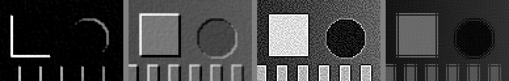

# FPGA Accelerator, Stage 4: running on the ML605 board

Stage 4 takes the accelerator from simulation onto the real Xilinx ML605 board (Virtex-6
XC6VLX240T-1FF1156). Earlier stages: [stage 2](https://github.com/solistolen/fpga-accelerator-stage2)
(MAC unit, Sobel edge detector) and [stage 3](https://github.com/solistolen/fpga-accelerator-stage3)
(systolic engine → complete int8 CNN layer at ~365 MHz in synthesis).

| Step | What | Status |
|---|---|---|
| **4a** | Board bring-up: heartbeat LED + UART echo | **Passed on the ML605** (2026-11-23): timing met at 200 MHz, LED blinks, UART echo PASS |
| **4b** | The CNN layer behind the UART: PC sends weights, parameters and an image; the board returns the 4 feature maps and a cycle count | **Passed on the ML605** (2026-11-23): both banks, all 5828 × 4 outputs match; 6165 clocks = 30.8 µs per frame at 200 MHz |
| **4c** | Measured FPGA vs GPU comparison | **Done** (2026-11-23): same layer on the ML605, an RX 7800 XT (OpenCL and PyTorch) and the CPU, all bit-exact. See below |

See [PROJECT_CONTEXT.md](PROJECT_CONTEXT.md) for the full project history, environment and how to
continue.

## Stage 4a: heartbeat LED and UART echo

The first design that runs on the board. It does nothing clever on purpose: it proves every piece
of the path from Verilog to hardware works (clock, pins, place-and-route, bitstream, programming,
PC link) before the CNN goes on the board.

- **LED 7 blinks** (about 1.5 times a second): the FPGA is configured and the 200 MHz clock runs.
- **UART echo + 1**: every byte the PC sends over the board's USB-UART comes back plus 1 (so a
  wiring loopback can't fake it). A 16-byte FIFO absorbs baud-rate mismatch between PC and FPGA.
- **LEDs 6–0** show the low 7 bits of the last byte received.
- Reset is generated internally at power-up (no reset button needed).

| File | What it is |
|---|---|
| rtl/4a_board_bringup/top_4a.v | Top level: 200 MHz LVDS clock → `IBUFGDS` → `BUFG` → `echo_core` |
| rtl/4a_board_bringup/echo_core.v | Power-on reset, heartbeat, UART receiver → FIFO (+1) → UART transmitter, LEDs |
| rtl/4a_board_bringup/uart_rx.v, uart_tx.v | 8N1 UART, 115200 baud (1736 clocks per bit at 200 MHz) |
| rtl/4a_board_bringup/ml605_4a.ucf | Pins and the 200 MHz timing constraint |
| sim/tb_echo_core.v | Testbench: 900 bytes in three phases (PC baud exact, 2.5% fast, 2.5% slow) |
| scripts/uart_test.py | PC side (Windows): checks the echo and measures throughput |

### Pins (UG534, ML605 Hardware User Guide)

| Port | Pin | Notes |
|---|---|---|
| SYSCLK_P / SYSCLK_N | J9 / H9 | 200 MHz 2.5 V LVDS oscillator U11 |
| UART_RX (FPGA input) | **J24** | board net `USB_1_TX` = CP2103 TXD (pin 25) |
| UART_TX (FPGA output) | **J25** | board net `USB_1_RX` = CP2103 RXD (pin 24) |
| GPIO_LED 0–7 | AC22, AC24, AE22, AE23, AB23, AG23, AE24, AD24 | |

The board's `USB_1_RX/TX` names describe the CP2103 bridge's pins, so the FPGA *receives* on the
net called `USB_1_TX`. Checked against UG534's master UCF (Appendix D), its USB-to-UART table
(Table 1-15), and the CP2103 datasheet.

**Don't confuse FPGA pins with board connectors.** The pins in this table are ball positions on the
FPGA package (FF1156: row letter + column number). The board's silkscreen uses the same "J"
prefix for its connectors: **J21** is the USB UART mini-B connector and **J22** is the USB JTAG
connector. The UART path is: PC USB cable → connector J21 → CP2103 bridge → FPGA balls J24/J25.
The JTAG connector J22 goes to the FPGA's dedicated configuration pins, so it never appears in a UCF.

### Verification (Icarus Verilog 12)

`tb_echo_core`: `PASS: 900 bytes echoed +1 in order (PC exact, 2.5% fast, 2.5% slow)`

| Planted bug | Result | Caught in |
|---|---|---|
| Receiver bit order reversed | FAIL | all phases |
| Receiver samples at bit edges instead of the middle | FAIL | PC 2.5% slow |
| Plain echo (no +1) | FAIL | all phases |
| Transmitter drops the stop bit | FAIL | PC 2.5% fast (replies back to back) |
| FIFO only 2 deep | FAIL | PC 2.5% fast |

The first version of the testbench ran only at the exact baud rate and missed the 2nd and 4th
bugs: with perfect timing, edge sampling still lands on the right bit, and a missing stop bit hides
in the idle time between replies. Hence the three phases, and a check that no two replies start
less than one 10-bit frame apart.

```
cd sim
iverilog -o echo_sim tb_echo_core.v ../rtl/4a_board_bringup/echo_core.v ../rtl/4a_board_bringup/uart_rx.v ../rtl/4a_board_bringup/uart_tx.v
vvp echo_sim
```

### Result on the ML605 (2026-11-23)

| Check | Result |
|---|---|
| Build (ISE 14.7, xc6vlx240t-1ff1156) | No errors; all signals routed; **All Constraints Met** (`TS_sysclk` 5 ns, 200 MHz), final timing score 0 |
| Programming (iMPACT over JTAG from the VirtualBox VM) | JTAG chain: Device 1 `xccace` (System ACE, bypassed), Device 2 `xc6vlx240t` → Program Succeeded |
| Heartbeat | **LED 7 blinks**: configured, 200 MHz clock running |
| UART (`scripts/uart_test.py`, CP2103 on COM3) | 256 values PASS, 2000-byte burst PASS, **11,453 bytes/s each way** (max 11,520 at 115200 8N1, i.e. 99.4%) |

```
Opening COM3 at 115200 baud, 8N1
  all values 0..255 (16 at a time)     PASS (256 bytes)
  2000 random bytes in one burst       PASS (2000 bytes)
  throughput: 11453 bytes/s each way (115200 baud, 10 bits/byte: max 11520)
PASS: the ML605 UART link works
```

This confirms the clock, LED and UART pins (including the confusingly named `USB_1_TX` = FPGA
receive on J24), the whole tool flow from the VM, and the UART logic in hardware. `DIFF_TERM = TRUE`
on SYSCLK was accepted as is. The only warnings were the usual unused LUT-RAM outputs
(`PhysDesignRules:367`, `Mram_fifo…_RAMD_D1_O`) from the 16-byte FIFO, which are harmless.

Bring-up notes: the Windows CP2103 showed in Device Manager with an error until the Silicon Labs
CP210x VCP driver was installed. In iMPACT, the first "Assign New Configuration File" dialog
(`*.mpm *.bsd`) is for the System ACE, so choose **Bypass** there and give `top_4a.bit` to the
second dialog.

### On the board

**1. Build in ISE.** New project (xc6vlx240t, ff1156, -1, XST, ISim, Verilog). Add `top_4a.v`,
`echo_core.v`, `uart_rx.v`, `uart_tx.v` (association **All**), `tb_echo_core.v` (**Simulation**)
and `ml605_4a.ucf` (**Implementation**). Top = `top_4a` → **Generate Programming File** (runs
synthesis, translate, map, place & route, bitgen → `top_4a.bit`). Check the Design Summary says
**All Constraints Met** (`TS_sysclk`, 5 ns). If Map/Bitgen complains about `DIFF_TERM` on SYSCLK,
delete `| DIFF_TERM = TRUE` from both SYSCLK lines and rebuild.

**2. Connect.** 12 V power, power switch on. Two USB cables: the **USB JTAG** mini-B (programming)
and the **USB UART** mini-B (CP2103). If ISE runs in a VirtualBox VM: pass only the JTAG device to
the VM (**Devices → USB**); leave the Silicon Labs CP210x on Windows.

**3. Program.** iMPACT → Boundary Scan → Initialize Chain → assign `top_4a.bit` to the
xc6vlx240t (bypass other devices) → Program. **LED 7 should blink.**

**4. Test the UART (Windows).** Device Manager → Ports → "Silicon Labs CP210x USB to UART Bridge
(COMx)" (install the CP210x driver if missing). `pip install pyserial`, then
`python scripts/uart_test.py` (finds the port itself; or give it, e.g. `COM5`; `--list` shows all
ports). Expected:

```
  all values 0..255 (16 at a time)     PASS (256 bytes)
  2000 random bytes in one burst       PASS (2000 bytes)
  throughput: ~11500 bytes/s each way
PASS: the ML605 UART link works
```

| Symptom | Likely cause |
|---|---|
| iMPACT finds no cable | JTAG USB not passed to the VM, or cable drivers missing in the VM |
| Programmed, but LED 7 doesn't blink | Clock not running: check the Map report for SYSCLK pin/IOSTANDARD messages |
| LED 7 blinks, but no UART reply | Wrong COM port, or the UART USB was passed to the VM |
| Replies but wrong values | Baud mismatch: script and FPGA must both be 115200 |

## Stage 4b: the CNN layer on the board

The Stage 3c CNN layer (`cnn_stream`: line buffer, 3×3 window, 4 systolic filters with two weight
banks, then bias, ReLU and requantization to 8 bits) now runs on the ML605. The UART from 4a
carries data in and out, and the computation itself runs entirely on chip:

```
PC --UART--> weights, requant params --> cnn_stream registers
PC --UART--> image -----> image BRAM --(1 pixel per clock, no gaps)--> cnn_stream --> result BRAM --UART--> PC
                                       \________ cycle counter: first read .. last result ________/
```

The UART runs at about 11.5 KB/s, which is fine for checking results but far too slow for video.
That's why the board measures the compute with its own cycle counter rather than by timing the
PC link.

| File | What it is |
|---|---|
| rtl/4b_cnn_board/top_4b.v | Top level: 200 MHz LVDS clock → `IBUFGDS` → `BUFG` → `cnn_board` |
| rtl/4b_cnn_board/cnn_board.v | Command FSM, image and result block RAMs, run engine, cycle counter, LEDs |
| rtl/4b_cnn_board/ml605_4b.ucf | Same pins and 200 MHz constraint as 4a |
| rtl/4a_board_bringup/uart_rx.v, uart_tx.v | The UART from 4a, unchanged |
| rtl/3c_cnn_layer/*.v | `cnn_stream`, `feature_stream`, `conv_layer`, `requant`: copied unchanged from the stage 3 repo |
| sim/tb_cnn_board.v | Testbench that drives only the UART pins, like the PC |
| sim/image.hex, weights.hex, quant.hex | Test image and parameters (the same as Stage 3c) |
| sim/expected_bank0.txt, expected_bank1.txt | Reference outputs from `cnn_ref.py` |
| scripts/cnn_ref.py | Python reference model (one bank per frame); writes the expected files |
| scripts/cnn_host.py | PC side: loads the board, runs both banks, checks every byte, prints timing, saves PNGs |

### Protocol (115200 8N1, little-endian)

| PC sends | Board answers | |
|---|---|---|
| `P` | `4B`, IMG_W (2 bytes), IMG_H (2 bytes) | ping and image size (96 × 64) |
| `W` + 72 bytes | `w` | weights: bank A filters 0–3 (9 taps each), then bank B |
| `Q` + 8 × 6 bytes | `q` | requant, bank A filters 0–3 then bank B: bias (3 bytes, 20-bit signed), mult (2), shift (1) |
| `I` + 6144 bytes | `i` | the image, row by row |
| `R` + bank | `r`, cycles (4 bytes), outputs (2 bytes) | run the whole frame with one bank |
| `O` | 5828 × 4 bytes, then `o` | the feature maps: f0 f1 f2 f3 per output pixel |
| anything else | `?` | |

If a command's data stops arriving for 0.67 s, the board drops that command, so an interrupted
script can't leave it stuck. LEDs: 7 heartbeat, 6 busy, 3 last run complete, 2 image loaded,
1 requant loaded, 0 weights loaded.

Two design details:
- **`cnn_stream` is reset (2 clocks) before every frame.** Its row counter doesn't wrap after a
  frame (it reaches 64), so without a reset the second frame's top rows would count as valid
  windows. The reset clears only the counters and valid flags, not the weights.
- **One bank per frame.** The bank is chosen in the `R` command. Switching banks inside a frame
  was already verified in Stage 3c.

### Result on the ML605 (2026-11-23)

```
  ping: Stage 4b board, image 96 x 64
  loaded weights (72 B, 0.008 s), requant (48 B, 0.005 s), image (6144 B, 0.533 s)
  bank 0:
    compute on the FPGA: 6165 clocks = 30.82 us at 200 MHz (6144 pixels in, 5828 x 4 out)
    read back 23312 bytes in 2.03 s (11512 bytes/s)
    PASS: all 5828 x 4 outputs match the reference model
  bank 1:
    compute on the FPGA: 6165 clocks = 30.82 us at 200 MHz (6144 pixels in, 5828 x 4 out)
    read back 23312 bytes in 2.02 s (11514 bytes/s)
    PASS: all 5828 x 4 outputs match the reference model
PASS: the CNN layer on the ML605 matches the reference for both banks
```

| | Result |
|---|---|
| Correctness | Every one of 2 × 5828 × 4 = 46,624 output bytes matches `cnn_ref.py`, both banks, first try |
| Compute | **6165 clocks = 30.8 µs** per 96×64 frame at 200 MHz: the same count as in Icarus and ISim |
| Transfer | Image upload 0.53 s, readback 2.0 s (UART at 99.9% of 115200 baud). Transfer is about 80,000× slower than compute, so 4c needs a faster link for any end-to-end comparison |
| Resources (XST) | 40 DSP48E1 (5%), 11 block RAMs (2%), 1891 LUTs, 1885 FFs (about 1%) |
| Timing | All Constraints Met at 200 MHz after place and route. XST estimate 272 MHz; the slowest path is the UART command FSM, not the CNN |
| Simulation | `tb_cnn_board` passes in both Icarus 12 and ISim 14.7 |

The board's feature maps (bank A: Sobel Gx, Sobel Gy, Laplacian, Gaussian; bank B: diagonal,
emboss, sharpen, extremes):




XST report excerpt: [results/synthesis/4b_cnn_board_xst.txt](results/synthesis/4b_cnn_board_xst.txt).

### Verification (Icarus Verilog 12)

`tb_cnn_board` drives only the UART pins, exactly as the PC does. It uses the real 96×64 image,
weights and protocol; only the UART is sped up to 8 clocks per bit, and the command timeout is
shortened to 2^12 clocks, to keep the run to about 5 minutes. It checks the ping, an unknown
command, recovery from a command interrupted after 10 bytes, loading, and then for **both banks**
the run reply and all 5828 × 4 output bytes against `cnn_ref.py`:

```
bank 0 run: 5828 outputs in 6165 clocks (30.82 us at 200 MHz)
bank 0 readback: 5828 x 4 bytes match expected_bank0.txt
bank 1 run: 5828 outputs in 6165 clocks (30.82 us at 200 MHz)
bank 1 readback: 5828 x 4 bytes match expected_bank1.txt
PASS: board protocol, 2 runs x 5828 pixels x 4 filters match the reference, 6165 clocks per frame
```

**6165 clocks = 6144 pixels + 21.** The image streams in at one pixel per clock, and the last
pixel's result is written 21 clocks later: 1 for the block-RAM read, 19 through `cnn_stream`, and
1 for the result register. The testbench requires exactly this count, so a stall or a gap in the
stream would fail it. At 200 MHz that's 30.8 µs per 96×64 frame. A 640×480 frame would take
about 307,221 clocks, or 1.54 ms (about 650 frames/s), if the image and result memories were made
large enough.

`cnn_ref.py` was cross-checked against Stage 3c's golden file: in the rows where Stage 3's bank
pattern is entirely A (564 outputs) or entirely B (3008 outputs), the two agree exactly.

Planted bugs (each one a single-line change in `cnn_board.v`), all caught:

| Planted bug | Caught by |
|---|---|
| No `cnn_stream` reset before a frame | 2nd run: 5973 clocks instead of 6165, and wrong outputs. The row counter carries on from the 1st frame, so the top 2 rows produce windows that shouldn't exist and the run "finishes" early |
| Bank byte ignored (always bank A) | bank 1: all 5828 outputs wrong |
| Readback bytes in reverse order | every output in both banks |
| Image read off by one pixel | 11,389 of 11,656 outputs |
| Bias bytes in the wrong order | 6973 outputs (only filters with a non-zero bias) |
| Run stops one result early | output count 5827 instead of 5828 |
| Weight bank split off by one (weight 35 into bank B) | bank A filter 3 wrong in every output |

```
cd scripts && python cnn_ref.py && cd ../sim
iverilog -o board_sim tb_cnn_board.v ../rtl/4b_cnn_board/cnn_board.v ../rtl/4a_board_bringup/uart_rx.v ../rtl/4a_board_bringup/uart_tx.v ../rtl/3c_cnn_layer/*.v
vvp board_sim
```

### On the board

**1. Build in ISE.** New project `Board4b` (xc6vlx240t, ff1156, -1, XST, ISim, Verilog). Add these
with association **All**: `top_4b.v`, `cnn_board.v`, `uart_rx.v`, `uart_tx.v`, `cnn_stream.v`,
`feature_stream.v`, `conv_layer.v`, `requant.v`. Add `tb_cnn_board.v` as **Simulation** and
`ml605_4b.ucf` as **Implementation**. Copy `image.hex`, `weights.hex`, `quant.hex` and the two
`expected_bank*.txt` files into the project folder for ISim. Set top = `top_4b`, then run
**Generate Programming File** and check **All Constraints Met**.

**2. Program** with iMPACT as in 4a: Bypass the `xccace`, assign `top_4b.bit` to the xc6vlx240t,
then Program. LED 7 blinks, and LEDs 0–6 stay off until data arrives.

**3. Run from Windows:** `python scripts/cnn_host.py`. Expected:

```
  ping: Stage 4b board, image 96 x 64
  loaded weights (72 B, ...), requant (48 B, ...), image (6144 B, ~0.53 s)
  bank 0:
    compute on the FPGA: 6165 clocks = 30.82 us at 200 MHz (6144 pixels in, 5828 x 4 out)
    read back 23312 bytes in ~2.0 s
    PASS: all 5828 x 4 outputs match the reference model
  bank 1: ... PASS
PASS: the CNN layer on the ML605 matches the reference for both banks
```

LEDs 0–3 light up as the data is loaded and the run completes. `board_bank0.png` and
`board_bank1.png` show the board's 4 feature maps side by side.

## Stage 4c: FPGA vs GPU

The same layer (4 filters, 3×3, int8 weights, bias + ReLU + requantization to 8 bits) runs on:
- **FPGA:** the ML605 design from 4b at 200 MHz.
- **GPU:** an AMD Radeon RX 7800 XT (RDNA 3, 60 CUs, 16 GB), in two ways:
  - a **hand-written OpenCL kernel**, with one work-item per output pixel doing the FPGA's integer math;
  - **PyTorch 2.15 on ROCm 10.2**, using `conv2d` in float32 (exact here, because every sum is below 2^24) followed by the requant in int64.
- **CPU:** vectorized NumPy on a Ryzen 7 5800X, as a baseline.

**Every implementation's output matches bit for bit.** NumPy matches `cnn_ref.py`, the model the board's outputs were checked against, on the real test image for both banks. Every other version is checked against NumPy at every size before it's timed.

| File | What it is |
|---|---|
| scripts/gpu_cnn.py | NumPy, OpenCL and PyTorch versions of the layer, with GPU-event timing |
| scripts/fpga_scale.py, sim/tb_cnn_scale.v | Board RTL (`cnn_stream`) at 640×480 and 1920×1080 in Icarus: checks every output and counts clocks |
| scripts/bench_4c.py | Runs everything; writes `results/bench_4c.json` and `results/bench_4c.md` (all tables) |

**Where the FPGA numbers come from:**
- **96×64:** measured on the board (Stage 4b).
- **640×480 and 1920×1080:** the board's memories only hold 96×64 frames, so these come from cycle-exact simulation of the same RTL. All 304,964 and 2,067,604 outputs match NumPy. The clock counts are exactly pixels + 19 (plus 2 in `cnn_board`), the same law the board measured.

**How the GPU was timed:** compute and transfers use the GPU's own event timers; "wall" is host time for the whole call. Each figure is the median of 50 runs.

### Results (µs)

| Frame | FPGA compute | GPU OpenCL kernel | GPU PyTorch compute | CPU NumPy |
|---|---|---|---|---|
| 96×64 | 30.8 *(measured)* | 3.8 | 319.7 | 344 |
| 640×480 | 1,536 | 10.1 | 626 | 36,515 |
| 1920×1080 | 10,368 | 46.2 | 3,458 | 249,379 |

| Frame | Throughput: FPGA | GPU OpenCL | GPU PyTorch | CPU NumPy |
|---|---|---|---|---|
| 640×480 | 651 fps | 121,501 fps | 3,671 fps | 27 fps |
| 1920×1080 | 96 fps | 21,944 fps | 375 fps | 4 fps |

| Frame | GPU OpenCL, one frame from host memory: upload + kernel + download (wall) | FPGA: last result after the last pixel |
|---|---|---|
| 640×480 | 88 + 10 + 116 µs (651–953 µs over 3 runs) | **0.105 µs** (21 clocks) |
| 1920×1080 | 118 + 46 + 785 µs (2,705–3,376 µs over 3 runs) | **0.105 µs** |

The full tables, including PyTorch transfer times and the UART times, are in [results/bench_4c.md](results/bench_4c.md).
That file holds the most recent run, so its numbers differ slightly from the ones above. Kernel and compute times repeat within a few percent between runs. End-to-end wall times vary by up to about ±40% (for example, OpenCL at 640×480 was 651 µs in one run and 940 µs in the next), because they include Windows scheduling, Python and driver overhead. Treat the end-to-end values as ranges.

### What the numbers say

1. **For raw throughput, the GPU wins by a lot.** At 640×480 the OpenCL kernel is about 150× faster than this FPGA design, and at 1080p about 225× faster. The FPGA design handles 1 pixel per clock at 200 MHz with 40 of its 768 DSPs (5%). The GPU has 3,840 shader lanes at about 2.25 GHz.
   - Even with all 768 DSPs used (about 19 pixels per clock) and the clock raised to the 272 MHz XST estimate, a 640×480 frame would take about 60 µs. That's still about 6× the GPU kernel.
   - This GPU (2023, 5/6 nm) is also about 14 years newer than the 40 nm Virtex-6 (2009).
2. **Both meet real-time video easily.** 640×480 at 30 fps allows 33 ms per frame. The FPGA needs 1.5 ms (5% of the budget), the GPU kernel 0.01 ms, and the GPU end to end 0.65–0.95 ms. The FPGA still manages 96 fps at 1080p. NumPy on the CPU just misses VGA (27 fps) and fails at 1080p (4 fps).
3. **For latency, the FPGA wins by orders of magnitude.** The FPGA processes pixels as they arrive: its last result leaves **21 clocks (105 ns)** after the frame's last pixel, using a buffer of only two image rows.
   - A GPU has to receive the whole frame, copy it across PCIe, run, and copy it back: 0.65–0.95 ms at VGA and 2.7–3.4 ms at 1080p from host memory.
   - With a camera, the GPU also has to wait for a full frame to be captured before it can start.
   - This is the classic FPGA advantage: deterministic, line-rate processing inside the video path.
4. **Transfer costs more than compute on both platforms.**
   - On the GPU, PCIe upload + download is 20× the kernel time at VGA.
   - On this FPGA, the 115200-baud UART makes a VGA frame take 26.7 s up and 106 s back.
   - **Placement matters more than raw speed:** the FPGA belongs between the camera and the host (in-line), or needs PCIe. The ML605 has a PCIe ×8 edge connector, which would be the next step.
5. **The framework costs about 60×.** PyTorch is bit-exact but about 60× slower per frame than the hand-written kernel at VGA, and 75× slower at 1080p. The causes: several kernel launches, the float32/int64 conversions, and MIOpen convolution without tuning data (it warns that its pre-tuned tables are missing). Even with frames back to back, PyTorch sustains only 3,671 fps, 33× below OpenCL. It is limited by the CPU launching about 10 small kernels per frame. (The GPU's event timers report about twice that rate, because they don't see the launch overhead. The throughput table uses the host wall clock, which is what you actually get.)
6. **Not measured yet: power.** The RX 7800 XT is rated at 263 W board power. The ML605 design is a few watts at most, but that needs to be measured, for example with ISE's XPower Analyzer and the board's power monitor. Energy per frame could reverse the throughput result, so it should be in the final trade study.

### Running it

Install the GPU libraries into the project, from your own terminal (about 4.6 GB):
```
pip install --target scripts/gpulib numpy pyopencl
pip install --target scripts/torchlib --index-url https://stable.repo.amd.com/rocm/whl-next/ --extra-index-url https://pypi.org/simple "torch[device-gfx1101]==2.15.0+rocm10.2.0"
```
`device-gfx1101` is for RX 7700/7800 GPUs; other AMD GPUs need their own device extra. Then:
```
cd scripts
python fpga_scale.py      # FPGA RTL at 640x480 and 1920x1080 in Icarus (about 6 minutes)
python bench_4c.py        # FPGA vs GPU vs CPU tables
```

### Measuring the FPGA's power

The GPU is rated at 263 W, so whether the FPGA wins on **energy per frame** depends on its real
power. There are two ways to get it, and they're best used together: an estimate from the tools,
and a measurement on the board.

#### Continuous mode (needed for the measurement)

A single `R` computes for only 30.8 µs, and then the board sits idle for seconds while the UART
works. No meter can see that. Stage 4b's `cnn_board` therefore has a **continuous mode**:
- `C` + bank: run the frame back to back, non-stop. LED 5 turns on.
- `S`: stop after the current frame. The board answers with the number of frames and clocks (a
  40-bit counter, good for 1.5 hours), so the frame rate during the measurement is exact.

`tb_cnn_board` checks it: about 3 frames, the clocks per frame, then a readback of the last frame.
In Icarus: `continuous: 4 frames in 24676 clocks = 6169 clocks per frame`, and the readback matches.
Each frame costs 4 clocks more than a single run: 1 for the restart and 2 for the `cnn_stream`
reset, plus 1 for handing the "done" signal to the command FSM. So the CNN is busy 99.94% of the
time, which is effectively continuous.

**On the ML605 (2026-11-23):** `power_run.py --seconds 10` gave
`324265 frames in 2000390785 clocks (10.00 s at 200 MHz; 10.00 s by the PC clock)`, which is
**6169.0 clocks = 30.84 µs per frame, 32,420 frames/s, 99.94% compute duty**. That's exactly
the simulated count. The board's clock count also agrees with the PC's clock to within 0.02%,
which confirms the 200 MHz oscillator. Running `cnn_host.py` right afterwards still passes for
both banks.
`scripts/power_run.py` drives it:

```
python power_run.py               # load, start, and wait for Enter
python power_run.py --seconds 60  # or stop by itself
```

#### A. Estimate with XPower Analyzer (ISE 14.7, no extra hardware)

1. Rebuild **Board4b** with the new `cnn_board.v` (copy it into `/home/ise/Board4b` and click Yes to
   reload it), then run **Generate Programming File**.
2. In the Processes panel, expand **Implement Design → Place & Route** and double-click
   **Analyze Power Distribution (XPower Analyzer)**. XPA opens the routed design (`top_4b.ncd`, `.pcf`).
3. In the left pane, check **By Type → Clocks** shows the 200 MHz clock (from the UCF's `TS_sysclk`).
4. Read the **Summary** page:
   - **Quiescent (static) power:** the chip's leakage. It's paid whether the design runs or not,
     and it's large for a 40 nm LX240T.
   - **Dynamic power:** per type (Clocks, Logic, Signals, BRAMs, DSPs, IOs). This is what the CNN adds.
   - **Total on-chip power,** and the junction temperature.
5. XPA doesn't know how busy the logic is. It assumes a default activity (toggle rate), which
   corresponds to the design computing continuously. So treat the dynamic number as an estimate
   for **continuous mode**, and compare it with B.

Send a screenshot of the Summary, and of By Type → DSP and BRAM if you can.

#### B. Measure on the board (not done: no meter available)

The board here is powered from a PC power supply's PCIe 12 V cable, and no PMBus adapter, PCIe power meter or DC clamp meter was available. So the results below use the XPower estimate (A). The procedure stays here for when equipment is available.


The ML605 uses two TI **UCD9240** digital power controllers on a PMBus (UG534, power section). In
the v1.9 rail table, **VCCINT** (the FPGA core, 1.0 V, where almost all the compute power goes) is
**Rail 1 of the UCD9240 at address 52**. Their voltage and current readings can be shown on a PC.
Use whichever option you have the equipment for:

| Option | Equipment | What it measures |
|---|---|---|
| **1. PMBus (best)** | TI **USB Interface Adapter** pod on the board's PMBus connector **J3**, and TI **Fusion Digital Power Designer** (free) on Windows | VCCINT voltage × current, and the other rails, live |
| **2. DC input** | An inline DC power meter between the 12 V adapter and the board | Whole-board power (12 V × current) |
| **3. Wall** | A plug-in AC power meter on the 12 V adapter's mains side | Whole-board power plus adapter losses (least precise) |

In every case, measure **twice and subtract**, so everything that isn't the CNN (fans, clocks, the
idle FPGA, the adapter) cancels out:

1. Program `top_4b.bit`. Leave the board running for about 2 minutes so the temperature settles.
   Read **P_idle** (design loaded, not computing).
2. Run `python power_run.py --seconds 120`. While it says RUNNING (LED 5 on), wait about 30 s, then
   read **P_run**.
3. Note the "µs per frame" it prints at the end (about 30.8 µs).
4. **Compute energy per frame** = (P_run − P_idle) × µs per frame. The whole-board version,
   P_run × µs per frame, is worth reporting too.

With option 1, also note the VCCINT voltage and current in both states. A small difference (tens of
mW) is plausible, because the design uses only about 5% of the chip, so take several readings and
average them.

The GPU side gets the same treatment next: idle versus a back-to-back run, read from the
RX 7800 XT's own power sensor (AMD Software's metrics overlay, or HWiNFO's "GPU ASIC/Total Board
Power").

### Energy per frame

**GPU, measured:** the RX 7800 XT's own board-power sensor, read through the AMD driver's ADL
library (`scripts/adl_power.py`, sensor 73). It reads about 20 W idle and 275 W under full load, in
line with the card's 263 W rating. Frames run back to back for 6 s per row while the sensor is
sampled. Energy per frame = average power ÷ frames per second.

**FPGA, estimated:** XPower Analyzer for the routed design at 200 MHz
([results/xpower_4b.txt](results/xpower_4b.txt)): **3.58 W = 3.44 W static + 0.137 W dynamic**.
It's combined with the continuous-mode frame rate (pixels + 25 clocks per frame).

| Frame | GPU OpenCL | GPU PyTorch | FPGA, whole chip | FPGA, dynamic only |
|---|---|---|---|---|
| 96×64 | 0.256 mJ (69 W) | 6.87 mJ (46 W) | **0.110 mJ** | 0.004 mJ |
| 640×480 | **2.00 mJ** (234 W) | 53.2 mJ (199 W) | 5.50 mJ | 0.210 mJ |
| 1920×1080 | **13.6 mJ** (275 W) | 539 mJ (200 W) | 37.1 mJ | 1.42 mJ |
| GPU above idle (−20 W), 640×480 | 1.83 mJ | | | |

Full table: [results/power_4c.md](results/power_4c.md). The numbers repeat within about 3% between runs.

**What it means:**
1. **Per frame, counting the whole chip, the GPU uses about 2.7× less energy** at 640×480 and
   1080p (2.0 vs 5.5 mJ at VGA). The FPGA's 3.44 W of static power is paid on every one of its
   (relatively slow) frames: 96% of its energy is leakage, because this design uses 5% of the chip
   at 1 pixel per clock. On the tiny 96×64 frame, the GPU can't fill itself (69 W, not 275 W), and
   the FPGA uses 2.3× less energy.
2. **Counting only the energy the computation adds, the FPGA wins by about 9×**: 0.21 mJ versus
   the GPU's 1.83 mJ above idle at VGA. Even if the DSPs' true power (which XPA reported as 0, an
   underestimate) tripled the FPGA's dynamic power, it would still win by about 3×.
3. **At the real requirement, 640×480 at 30 fps, the FPGA needs about 6× less power.** The
   GPU board idles at about 20 W and adds 30 × 1.83 mJ = 0.05 W, so about **20 W**. The FPGA chip
   needs 3.44 W static plus 30/651 of its 0.137 W dynamic, so about **3.45 W**. That doesn't even
   count the PC around the GPU (CPU, memory, chipset). For an embedded video pipeline, this is
   the number that matters.
4. **A wider FPGA design would win on energy outright.** Static power doesn't grow with the work
   done. Using all 768 DSPs (about 19 pixels per clock) would multiply the frame rate by about 19,
   while static stays 3.44 W and dynamic grows to about 19 × 0.137 = 2.6 W. That's about 6 W for
   12,400 fps, or about 0.5 mJ per VGA frame,
   roughly 4× better than the GPU. This is a projection, not a measurement.
5. **A framework costs energy too.** PyTorch needs 27× the energy per frame of the hand-written
   OpenCL kernel at VGA (53 vs 2.0 mJ). It keeps the GPU at about 200 W while the CPU-bound launches
   leave it half idle.

**Limits:**
- The FPGA figures are tool estimates, not measurements. XPA used its default activity and a 50 °C
  ambient, and its DSP figure (0.000 W) is clearly too low.
- The GPU figures are the card's own sensor, which AMD reports as total board power.
- Neither side includes the host PC, or the rest of the system. See the system-level view below.

```
cd scripts
python power_4c.py        # GPU power and energy per frame (about 1 minute; leave the PC idle)
python power_run.py       # board continuous mode, for a future measurement with a meter
```

### System-level view

All the power figures above are at the **chip or card level**. A complete video system contains
more than that, and the two platforms fit into a system differently.

| | Included in the figures above | Not included |
|---|---|---|
| **GPU** | The graphics card's total board power, from its own sensor | The host PC the card needs: CPU, motherboard, RAM, storage and power-supply losses, plus the CPU's extra work while driving the GPU. PyTorch is CPU-bound, so a CPU core was busy during its runs |
| **FPGA** | The xc6vlx240t chip itself (XPower Analyzer estimate) | The rest of the ML605 board (DDR3 memory, oscillators, the USB-UART bridge, LEDs, and the regulators' losses converting 12 V to the chip's supplies), and the PC that supplied frames over the UART in these tests |

**How each platform would be deployed:**
- **GPU:** it can't run on its own. A GPU-based pipeline is always camera → host PC → GPU card →
  host PC, so the PC's power is part of the cost of every frame. A desktop like the one used here
  typically draws several tens of watts at idle, on top of the card's own 20 W.
- **FPGA:** it can sit **inside the video path**: camera → FPGA → output or network, with no PC.
  Control can come from a small processor on the same chip or board. The PC and UART in these tests
  were only a way to load test data and read results back, not part of a deployed design. Pixels
  would arrive from the camera at the rate the design already handles, one per clock.

**What this means for the comparison:**
- At the requirement (640×480 at 30 fps), the chip-level figures are **about 3.45 W for the FPGA
  versus about 20 W for the GPU card**.
- At the system level, the gap is most likely **larger**: the GPU needs a whole PC, while the FPGA
  needs only its own board.
- At maximum throughput, the GPU's per-frame energy advantage (2.0 vs 5.5 mJ at VGA, whole chip)
  would shrink once the PC's power is shared across its frames, but it would probably remain.

**What would firm this up:**
1. A plug-in wall meter on the PC, idle versus running `power_4c.py`: the GPU system's total.
2. The ML605's 12 V input (an inline PCIe power meter on its cable) or its PMBus rails (TI adapter
   on J3): the FPGA board's total, using `power_run.py`.
3. For a deployed design, an estimate for a smaller, newer FPGA sized for the job. Most of this
   chip's 3.44 W is the leakage of a large 2009-era device that this design uses only 5% of.

None of these system-level numbers have been measured here, so the recommendation rests on the
chip-level figures plus the deployment argument above.
