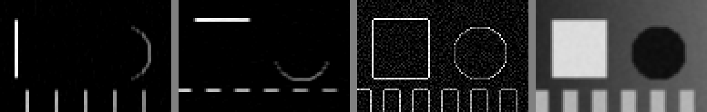

# FPGA Accelerator, Stage 4: running on the ML605 board

Stage 4 takes the accelerator from simulation onto the real Xilinx ML605 board (Virtex-6
XC6VLX240T-1FF1156). Earlier stages: [stage 2](https://github.com/solistolen/fpga-accelerator-stage2)
(MAC unit, Sobel edge detector) and [stage 3](https://github.com/solistolen/fpga-accelerator-stage3)
(systolic engine → complete int8 CNN layer at ~365 MHz in synthesis).

| Step | What | Status |
|---|---|---|
| **4a** | Board bring-up: heartbeat LED + UART echo | **Passed on the ML605** (2026-11-23): timing met at 200 MHz, LED blinks, UART echo PASS |
| **4b** | The CNN layer behind the UART: PC sends weights, parameters and an image; the board returns the 4 feature maps and a cycle count | **Passed on the ML605** (2026-11-23): both banks, all 5828 × 4 outputs match; 6165 clocks = 30.8 µs per frame at 200 MHz |
| 4c | Measured FPGA vs GPU comparison | Planned |

See [PROJECT_CONTEXT.md](PROJECT_CONTEXT.md) for the full project history, environment and how to
continue.

## Stage 4a: heartbeat LED and UART echo

The first design that runs on the board. It does nothing clever on purpose: it proves every piece
of the path from Verilog to hardware works (clock, pins, place-and-route, bitstream, programming,
PC link) before the CNN goes on the board.

- **LED 7 blinks** (about 1.5 times a second): the FPGA is configured and the 200 MHz clock runs.
- **UART echo + 1**: every byte the PC sends over the board's USB-UART comes back plus 1 (so a
  wiring loopback can't fake it). A 16-byte FIFO absorbs baud-rate mismatch between PC and FPGA.
- **LEDs 6–0** show the low 7 bits of the last byte received.
- Reset is generated internally at power-up (no reset button needed).

| File | What it is |
|---|---|
| rtl/4a_board_bringup/top_4a.v | Top level: 200 MHz LVDS clock → `IBUFGDS` → `BUFG` → `echo_core` |
| rtl/4a_board_bringup/echo_core.v | Power-on reset, heartbeat, UART receiver → FIFO (+1) → UART transmitter, LEDs |
| rtl/4a_board_bringup/uart_rx.v, uart_tx.v | 8N1 UART, 115200 baud (1736 clocks per bit at 200 MHz) |
| rtl/4a_board_bringup/ml605_4a.ucf | Pins and the 200 MHz timing constraint |
| sim/tb_echo_core.v | Testbench: 900 bytes in three phases (PC baud exact, 2.5% fast, 2.5% slow) |
| scripts/uart_test.py | PC side (Windows): checks the echo and measures throughput |

### Pins (UG534, ML605 Hardware User Guide)

| Port | Pin | Notes |
|---|---|---|
| SYSCLK_P / SYSCLK_N | J9 / H9 | 200 MHz 2.5 V LVDS oscillator U11 |
| UART_RX (FPGA input) | **J24** | board net `USB_1_TX` = CP2103 TXD (pin 25) |
| UART_TX (FPGA output) | **J25** | board net `USB_1_RX` = CP2103 RXD (pin 24) |
| GPIO_LED 0–7 | AC22, AC24, AE22, AE23, AB23, AG23, AE24, AD24 | |

The board's `USB_1_RX/TX` names describe the CP2103 bridge's pins, so the FPGA *receives* on the
net called `USB_1_TX`. Checked against UG534's master UCF (Appendix D), its USB-to-UART table
(Table 1-15), and the CP2103 datasheet.

**Don't confuse FPGA pins with board connectors.** The pins in this table are ball positions on the
FPGA package (FF1156: row letter + column number). The board's silkscreen uses the same "J"
prefix for its connectors: **J21** is the USB UART mini-B connector and **J22** is the USB JTAG
connector. The UART path is: PC USB cable → connector J21 → CP2103 bridge → FPGA balls J24/J25.
The JTAG connector J22 goes to the FPGA's dedicated configuration pins, so it never appears in a UCF.

### Verification (Icarus Verilog 12)

`tb_echo_core`: `PASS: 900 bytes echoed +1 in order (PC exact, 2.5% fast, 2.5% slow)`

| Planted bug | Result | Caught in |
|---|---|---|
| Receiver bit order reversed | FAIL | all phases |
| Receiver samples at bit edges instead of the middle | FAIL | PC 2.5% slow |
| Plain echo (no +1) | FAIL | all phases |
| Transmitter drops the stop bit | FAIL | PC 2.5% fast (replies back to back) |
| FIFO only 2 deep | FAIL | PC 2.5% fast |

The first version of the testbench ran only at the exact baud rate and missed the 2nd and 4th
bugs: with perfect timing, edge sampling still lands on the right bit, and a missing stop bit hides
in the idle time between replies. Hence the three phases, and a check that no two replies start
less than one 10-bit frame apart.

```
cd sim
iverilog -o echo_sim tb_echo_core.v ../rtl/4a_board_bringup/echo_core.v ../rtl/4a_board_bringup/uart_rx.v ../rtl/4a_board_bringup/uart_tx.v
vvp echo_sim
```

### Result on the ML605 (2026-11-23)

| Check | Result |
|---|---|
| Build (ISE 14.7, xc6vlx240t-1ff1156) | No errors; all signals routed; **All Constraints Met** (`TS_sysclk` 5 ns, 200 MHz), final timing score 0 |
| Programming (iMPACT over JTAG from the VirtualBox VM) | JTAG chain: Device 1 `xccace` (System ACE, bypassed), Device 2 `xc6vlx240t` → Program Succeeded |
| Heartbeat | **LED 7 blinks**: configured, 200 MHz clock running |
| UART (`scripts/uart_test.py`, CP2103 on COM3) | 256 values PASS, 2000-byte burst PASS, **11,453 bytes/s each way** (max 11,520 at 115200 8N1, i.e. 99.4%) |

```
Opening COM3 at 115200 baud, 8N1
  all values 0..255 (16 at a time)     PASS (256 bytes)
  2000 random bytes in one burst       PASS (2000 bytes)
  throughput: 11453 bytes/s each way (115200 baud, 10 bits/byte: max 11520)
PASS: the ML605 UART link works
```

This confirms the clock, LED and UART pins (including the confusingly named `USB_1_TX` = FPGA
receive on J24), the whole tool flow from the VM, and the UART logic in hardware. `DIFF_TERM = TRUE`
on SYSCLK was accepted as is. The only warnings were the usual unused LUT-RAM outputs
(`PhysDesignRules:367`, `Mram_fifo…_RAMD_D1_O`) from the 16-byte FIFO, which are harmless.

Bring-up notes: the Windows CP2103 showed in Device Manager with an error until the Silicon Labs
CP210x VCP driver was installed. In iMPACT, the first "Assign New Configuration File" dialog
(`*.mpm *.bsd`) is for the System ACE, so choose **Bypass** there and give `top_4a.bit` to the
second dialog.

### On the board

**1. Build in ISE.** New project (xc6vlx240t, ff1156, -1, XST, ISim, Verilog). Add `top_4a.v`,
`echo_core.v`, `uart_rx.v`, `uart_tx.v` (association **All**), `tb_echo_core.v` (**Simulation**)
and `ml605_4a.ucf` (**Implementation**). Top = `top_4a` → **Generate Programming File** (runs
synthesis, translate, map, place & route, bitgen → `top_4a.bit`). Check the Design Summary says
**All Constraints Met** (`TS_sysclk`, 5 ns). If Map/Bitgen complains about `DIFF_TERM` on SYSCLK,
delete `| DIFF_TERM = TRUE` from both SYSCLK lines and rebuild.

**2. Connect.** 12 V power, power switch on. Two USB cables: the **USB JTAG** mini-B (programming)
and the **USB UART** mini-B (CP2103). If ISE runs in a VirtualBox VM: pass only the JTAG device to
the VM (**Devices → USB**); leave the Silicon Labs CP210x on Windows.

**3. Program.** iMPACT → Boundary Scan → Initialize Chain → assign `top_4a.bit` to the
xc6vlx240t (bypass other devices) → Program. **LED 7 should blink.**

**4. Test the UART (Windows).** Device Manager → Ports → "Silicon Labs CP210x USB to UART Bridge
(COMx)" (install the CP210x driver if missing). `pip install pyserial`, then
`python scripts/uart_test.py` (finds the port itself; or give it, e.g. `COM5`; `--list` shows all
ports). Expected:

```
  all values 0..255 (16 at a time)     PASS (256 bytes)
  2000 random bytes in one burst       PASS (2000 bytes)
  throughput: ~11500 bytes/s each way
PASS: the ML605 UART link works
```

| Symptom | Likely cause |
|---|---|
| iMPACT finds no cable | JTAG USB not passed to the VM, or cable drivers missing in the VM |
| Programmed, but LED 7 doesn't blink | Clock not running: check the Map report for SYSCLK pin/IOSTANDARD messages |
| LED 7 blinks, but no UART reply | Wrong COM port, or the UART USB was passed to the VM |
| Replies but wrong values | Baud mismatch: script and FPGA must both be 115200 |

## Stage 4b: the CNN layer on the board

The Stage 3c CNN layer (`cnn_stream`: line buffer, 3×3 window, 4 systolic filters with two weight
banks, then bias, ReLU and requantization to 8 bits) now runs on the ML605. The UART from 4a
carries data in and out, and the computation itself runs entirely on chip:

```
PC --UART--> weights, requant params --> cnn_stream registers
PC --UART--> image -----> image BRAM --(1 pixel per clock, no gaps)--> cnn_stream --> result BRAM --UART--> PC
                                       \________ cycle counter: first read .. last result ________/
```

The UART runs at about 11.5 KB/s, which is fine for checking results but far too slow for video.
That's why the board measures the compute with its own cycle counter rather than by timing the
PC link.

| File | What it is |
|---|---|
| rtl/4b_cnn_board/top_4b.v | Top level: 200 MHz LVDS clock → `IBUFGDS` → `BUFG` → `cnn_board` |
| rtl/4b_cnn_board/cnn_board.v | Command FSM, image and result block RAMs, run engine, cycle counter, LEDs |
| rtl/4b_cnn_board/ml605_4b.ucf | Same pins and 200 MHz constraint as 4a |
| rtl/4a_board_bringup/uart_rx.v, uart_tx.v | The UART from 4a, unchanged |
| rtl/3c_cnn_layer/*.v | `cnn_stream`, `feature_stream`, `conv_layer`, `requant`: copied unchanged from the stage 3 repo |
| sim/tb_cnn_board.v | Testbench that drives only the UART pins, like the PC |
| sim/image.hex, weights.hex, quant.hex | Test image and parameters (the same as Stage 3c) |
| sim/expected_bank0.txt, expected_bank1.txt | Reference outputs from `cnn_ref.py` |
| scripts/cnn_ref.py | Python reference model (one bank per frame); writes the expected files |
| scripts/cnn_host.py | PC side: loads the board, runs both banks, checks every byte, prints timing, saves PNGs |

### Protocol (115200 8N1, little-endian)

| PC sends | Board answers | |
|---|---|---|
| `P` | `4B`, IMG_W (2 bytes), IMG_H (2 bytes) | ping and image size (96 × 64) |
| `W` + 72 bytes | `w` | weights: bank A filters 0–3 (9 taps each), then bank B |
| `Q` + 8 × 6 bytes | `q` | requant, bank A filters 0–3 then bank B: bias (3 bytes, 20-bit signed), mult (2), shift (1) |
| `I` + 6144 bytes | `i` | the image, row by row |
| `R` + bank | `r`, cycles (4 bytes), outputs (2 bytes) | run the whole frame with one bank |
| `O` | 5828 × 4 bytes, then `o` | the feature maps: f0 f1 f2 f3 per output pixel |
| anything else | `?` | |

If a command's data stops arriving for 0.67 s, the board drops that command, so an interrupted
script can't leave it stuck. LEDs: 7 heartbeat, 6 busy, 3 last run complete, 2 image loaded,
1 requant loaded, 0 weights loaded.

Two design details:
- **`cnn_stream` is reset (2 clocks) before every frame.** Its row counter doesn't wrap after a
  frame (it reaches 64), so without a reset the second frame's top rows would count as valid
  windows. The reset clears only the counters and valid flags, not the weights.
- **One bank per frame.** The bank is chosen in the `R` command. Switching banks inside a frame
  was already verified in Stage 3c.

### Result on the ML605 (2026-11-23)

```
  ping: Stage 4b board, image 96 x 64
  loaded weights (72 B, 0.008 s), requant (48 B, 0.005 s), image (6144 B, 0.533 s)
  bank 0:
    compute on the FPGA: 6165 clocks = 30.82 us at 200 MHz (6144 pixels in, 5828 x 4 out)
    read back 23312 bytes in 2.03 s (11512 bytes/s)
    PASS: all 5828 x 4 outputs match the reference model
  bank 1:
    compute on the FPGA: 6165 clocks = 30.82 us at 200 MHz (6144 pixels in, 5828 x 4 out)
    read back 23312 bytes in 2.02 s (11514 bytes/s)
    PASS: all 5828 x 4 outputs match the reference model
PASS: the CNN layer on the ML605 matches the reference for both banks
```

| | Result |
|---|---|
| Correctness | Every one of 2 × 5828 × 4 = 46,624 output bytes matches `cnn_ref.py`, both banks, first try |
| Compute | **6165 clocks = 30.8 µs** per 96×64 frame at 200 MHz: the same count as in Icarus and ISim |
| Transfer | Image upload 0.53 s, readback 2.0 s (UART at 99.9% of 115200 baud). Transfer is about 80,000× slower than compute, so 4c needs a faster link for any end-to-end comparison |
| Resources (XST) | 40 DSP48E1 (5%), 11 block RAMs (2%), 1891 LUTs, 1885 FFs (about 1%) |
| Timing | All Constraints Met at 200 MHz after place and route. XST estimate 272 MHz; the slowest path is the UART command FSM, not the CNN |
| Simulation | `tb_cnn_board` passes in both Icarus 12 and ISim 14.7 |

The board's feature maps (bank A: Sobel Gx, Sobel Gy, Laplacian, Gaussian; bank B: diagonal,
emboss, sharpen, extremes):




XST report excerpt: [results/synthesis/4b_cnn_board_xst.txt](results/synthesis/4b_cnn_board_xst.txt).

### Verification (Icarus Verilog 12)

`tb_cnn_board` drives only the UART pins, exactly as the PC does. It uses the real 96×64 image,
weights and protocol; only the UART is sped up to 8 clocks per bit, and the command timeout is
shortened to 2^12 clocks, to keep the run to about 5 minutes. It checks the ping, an unknown
command, recovery from a command interrupted after 10 bytes, loading, and then for **both banks**
the run reply and all 5828 × 4 output bytes against `cnn_ref.py`:

```
bank 0 run: 5828 outputs in 6165 clocks (30.82 us at 200 MHz)
bank 0 readback: 5828 x 4 bytes match expected_bank0.txt
bank 1 run: 5828 outputs in 6165 clocks (30.82 us at 200 MHz)
bank 1 readback: 5828 x 4 bytes match expected_bank1.txt
PASS: board protocol, 2 runs x 5828 pixels x 4 filters match the reference, 6165 clocks per frame
```

**6165 clocks = 6144 pixels + 21.** The image streams in at one pixel per clock, and the last
pixel's result is written 21 clocks later: 1 for the block-RAM read, 19 through `cnn_stream`, and
1 for the result register. The testbench requires exactly this count, so a stall or a gap in the
stream would fail it. At 200 MHz that's 30.8 µs per 96×64 frame. A 640×480 frame would take
about 307,221 clocks, or 1.54 ms (about 650 frames/s), if the image and result memories were made
large enough.

`cnn_ref.py` was cross-checked against Stage 3c's golden file: in the rows where Stage 3's bank
pattern is entirely A (564 outputs) or entirely B (3008 outputs), the two agree exactly.

Planted bugs (each one a single-line change in `cnn_board.v`), all caught:

| Planted bug | Caught by |
|---|---|
| No `cnn_stream` reset before a frame | 2nd run: 5973 clocks instead of 6165, and wrong outputs. The row counter carries on from the 1st frame, so the top 2 rows produce windows that shouldn't exist and the run "finishes" early |
| Bank byte ignored (always bank A) | bank 1: all 5828 outputs wrong |
| Readback bytes in reverse order | every output in both banks |
| Image read off by one pixel | 11,389 of 11,656 outputs |
| Bias bytes in the wrong order | 6973 outputs (only filters with a non-zero bias) |
| Run stops one result early | output count 5827 instead of 5828 |
| Weight bank split off by one (weight 35 into bank B) | bank A filter 3 wrong in every output |

```
cd scripts && python cnn_ref.py && cd ../sim
iverilog -o board_sim tb_cnn_board.v ../rtl/4b_cnn_board/cnn_board.v ../rtl/4a_board_bringup/uart_rx.v ../rtl/4a_board_bringup/uart_tx.v ../rtl/3c_cnn_layer/*.v
vvp board_sim
```

### On the board

**1. Build in ISE.** New project `Board4b` (xc6vlx240t, ff1156, -1, XST, ISim, Verilog). Add these
with association **All**: `top_4b.v`, `cnn_board.v`, `uart_rx.v`, `uart_tx.v`, `cnn_stream.v`,
`feature_stream.v`, `conv_layer.v`, `requant.v`. Add `tb_cnn_board.v` as **Simulation** and
`ml605_4b.ucf` as **Implementation**. Copy `image.hex`, `weights.hex`, `quant.hex` and the two
`expected_bank*.txt` files into the project folder for ISim. Set top = `top_4b`, then run
**Generate Programming File** and check **All Constraints Met**.

**2. Program** with iMPACT as in 4a: Bypass the `xccace`, assign `top_4b.bit` to the xc6vlx240t,
then Program. LED 7 blinks, and LEDs 0–6 stay off until data arrives.

**3. Run from Windows:** `python scripts/cnn_host.py`. Expected:

```
  ping: Stage 4b board, image 96 x 64
  loaded weights (72 B, ...), requant (48 B, ...), image (6144 B, ~0.53 s)
  bank 0:
    compute on the FPGA: 6165 clocks = 30.82 us at 200 MHz (6144 pixels in, 5828 x 4 out)
    read back 23312 bytes in ~2.0 s
    PASS: all 5828 x 4 outputs match the reference model
  bank 1: ... PASS
PASS: the CNN layer on the ML605 matches the reference for both banks
```

LEDs 0–3 light up as the data is loaded and the run completes. `board_bank0.png` and
`board_bank1.png` show the board's 4 feature maps side by side.
